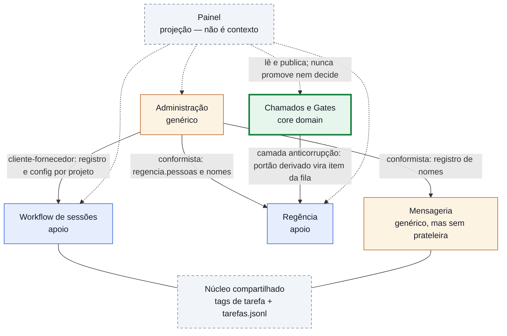

# Mapa de contextos delimitados — Maestro (ciclo 073, rodada 2, passo 3)

> O mapa estratégico de *Domain-Driven Design* (DDD — desenho orientado ao domínio) do Maestro,
> no estilo Vaughn Vernon (*Implementing Domain-Driven Design*): **quais são os contextos
> delimitados**, **como eles se relacionam** (cliente-fornecedor, conformista, camada
> anticorrupção, núcleo compartilhado), **qual é o core domain** e **qual vocabulário cada
> contexto fala**. É leitura do repositório, não arquitetura decidida: nada aqui se constrói —
> os wireframes (rodada 3) e o bar de três críticos (rodada 4) vêm depois.

- **Data**: 2026-10-25 · **Ciclo**: 073 (área administrativa) · **Rodada**: 2 (confronto) · **Passo**: 3 (mapa)
- **Autor**: Worker02 · **Base**: `02dae14` · **Insumos**: `confronto/confronto-decisao.md` (as 26
  funcionalidades e as 13 `ENTRA`), `confronto/inventario-maestro.md` (onde as coisas vivem hoje),
  `docs/governance/` (`principles.md`, `operating-model.md`, `task-ledger.md`, glossário),
  `painel/` e os ADR (*Architecture Decision Record* — registro de decisão de arquitetura) 0018
  (fronteira interna) e 0027 (fila e append-only mecânico).

**Siglas** (expandidas na primeira ocorrência, Princípio VIII): DDD (*Domain-Driven Design*) ·
ADR (*Architecture Decision Record*) · FR (*functional requirement*, requisito funcional) ·
JSONL (*JSON Lines*, um objeto JSON por linha) · MCP (*Model Context Protocol*) · A2A
(*Agent-to-Agent*) · RACI (*Responsible, Accountable, Consulted, Informed*) · RBAC (*Role-Based
Access Control*) · LLM (*Large Language Model*) · YAGNI (*You Aren't Gonna Need It*) ·
CI (*Continuous Integration*, integração contínua).

---

## 1. Por que um mapa de contextos (e o que ele **não** é)

O glossário já define **contexto delimitado** (*bounded context*) como **"a costura pela qual o
trabalho é cortado para paralelismo seguro"** (`docs/governance/glossary.md`). O 073 mediu que o
Maestro **já tem** os contextos — o que ele não tem é o **mapa**: quem depende de quem, onde a
linguagem muda de sentido e onde um nome igual aponta para duas coisas.

Três usos concretos deste mapa:

1. **A rodada 3** (wireframes, que por decisão do regente são "sobre contexto delimitado de DDD e
   linguagem ubíqua", `spec.md`) precisa saber **a que contexto cada tela pertence** — senão a
   tela da fila de decisões e a tela de mensagens nascem parecidas e divergem.
2. **As 13 `ENTRA` da rodada 2** precisam de casa: cada funcionalidade que entra vai pertencer a
   **um** contexto, com invariante declarado (é a disciplina `DOM:invariants=` que o 067 já exige
   de todo plano).
3. **Quem mexer num contexto amanhã** precisa saber o que quebra longe dali — os relacionamentos
   abaixo dizem qual vizinho sente a mudança.

O que ele **não** é: não é arquitetura de software, não é desenho de tela e não decide nada sobre
o que entra (isso foi o passo 2, `confronto-decisao.md`). Nenhum arquivo de `painel/` ou `scripts/`
foi tocado.

## 2. O corte: cinco contextos delimitados

Leitura do repositório em cinco contextos. A proposta do regente foi seguida; o que mudei está
declarado ao fim desta seção.

| Contexto | A pergunta que ele responde | Onde ele vive hoje (evidência) | O que ele **possui** (raiz e invariantes) |
|---|---|---|---|
| **Chamados e Gates** *(core domain)* | "Este ciclo existe, cumpriu os portões e foi aceito?" | `specs/<id>/` (pasta do chamado + um arquivo por veredito), `painel/chamados.py` (o conferidor), `painel/server.py` (rotas do kanban), `docs/jornada/` (jornada viva) | Raiz: **Chamado** (glossário, ciclo 068 — "a raiz de agregação do painel"). Invariantes: o estado do portão é **derivado** dos arquivos, nunca digitado; o veredito tem cabeçalho válido, autor ≠ crítico, data legível e não posterior ao commit; só vale com `runner2` limpo |
| **Workflow de sessões** | "Quem está fazendo o quê, agora, e em que passo do ciclo?" | Tabelas `rodadas`, `passos`, `transicoes` (`painel/schema_workflow.sql`), hooks (`painel/hooks/`), lançador de sessões (`scripts/multi-session.py`), livro de ponto (`docs/records/tarefas.jsonl`) | Raiz: **Rodada**, com os **Passos** (glossário, ciclo 070). Invariantes: *append-only* imposto por gatilho (ADR 0027); **um passo sem saída bloqueia a entrada do próximo**; "one active task per session" (`docs/governance/task-ledger.md`) |
| **Regência** | "O que espera decisão **humana** — e o que o humano já decidiu?" | `painel/regencia/` (domínio puro: fila, kanban, normalização), registro da fila em JSONL (`painel/dados/fila-<projeto>.jsonl`, ADR 0027), rotas `/api/regencia/*`, tela lida pelo painel | Raiz: **Pedido de decisão**, fechado por um **Ruling** (glossário, ciclo 072). Invariantes: ruling **sem autor humano ou sem destino é recusado**; o autor tem de estar em `regencia.pessoas`; o painel **nunca promove nem decide** |
| **Administração** | "Quem existe, com que papel, ferramenta e configuração?" | `docs/agents/README.md` (perfil ↔ executável), `.claude/agents/`, `skills/<nome>/SKILL.md`, `scripts/check-agents.sh`/`check-roles.sh`/`check-install.sh`, instalador (`scripts/install-maestro.sh`), `boundary.json` (ADR 0018), índice de decisões (`scripts/record-decision.sh`) | Raiz: **Agente** (registro) e **Projeto** (configuração). Invariantes: toda afirmação do registro tem invariante que a verifica; **todo arquivo tem domínio declarado** (fronteira interna, ADR 0018); autorização vive **fora** do modelo |
| **Mensageria** | "Como uma sessão fala com outra — e o que ficou registrado?" | *Outbox* SQLite `painel/fila_outbox.py` (`FilaOutbox`, drenagem), protocolo `[[TASK]]`/`[[DONE]]` (`docs/governance/task-ledger.md`), servidor MCP `painel/mcp_painel.py`, mod `mods/maestro-ledger`, canonização de nomes (`painel/ingest.py`, `norm_sessao`) | Raiz: **Mensagem** (linha da *outbox*, endereçada a uma sessão). Invariantes: a fila recusa `DELETE` e só aceita o fechamento da leitura (`lida_em`, ADR 0027); endereçar por nome exige canonização (houve incidente real de nomes cruzados) |

### Ajustes que fiz no corte — declarados

- **O painel não é um contexto; é uma projeção.** O glossário é explícito: o painel "**nunca
  promove e nunca decide**" e o SQLite dele é "projeção reconstruível" (`painel/README.md`). Um
  *read-model* que serve **quatro** contextos não é dono de invariante nenhum — por isso ele
  aparece no diagrama como caixa pontilhada, **fora** do corte.
- **Considerei um sexto contexto e recusei.** Custo e consumo têm depósito próprio
  (`painel/custo.py`, `dados/custo.db`) e relatório próprio (`scripts/report-tasks.py`), o que
  sugeriria um contexto de **Medição**. Não é: o `custo.py` é **índice de leitura** alimentado
  pelos transcritos de sessão — projeção, como o painel. Criar contexto para uma projeção
  duplicaria função já servida (Princípio VI) e inflaria o mapa sem caso hoje (YAGNI, Princípio
  VII). O consumo **novo** que entra (`consumo por agente`) é do Workflow de sessões, que já é
  dono do livro de ponto.
- **Os grupos CONTROLE e GERENCIAMENTO da matriz não viram contexto.** As funcionalidades
  `ENTRA` desses grupos caem em dois contextos que já existem — **Workflow de sessões** (sessão de
  agente, estado do agente vivo, tarefa aberta, consumo por agente, limite de orçamento) e
  **Administração** (catálogo de skills/ferramentas/modelos). Cortar por grupo da pesquisa seria
  cortar por **assunto de compra**, não por **domínio** — o mapa é de domínio.

## 3. O mapa

Leitura do diagrama: **seta cheia** = dependência (o sentido é o do fluxo de informação
*upstream → downstream*); **linha sem seta** = núcleo compartilhado (os dois lados usam a mesma
peça e mudam juntos); **linha pontilhada** = projeção (leitura, sem dependência de domínio).

## 4. Os relacionamentos, um a um

Sete relações, na ordem em que importam para quem for mexer no repositório. Cada uma traz o
**tipo** e **uma frase de motivo** — como o despacho pediu.

1. **Administração → Workflow de sessões · cliente-fornecedor** (Administração *upstream*,
   Workflow *downstream*).
   *Motivo:* o lançador e o instalador decidem **quem existe e com que configuração** —
   `scripts/multi-session.py` traz a lista de sessões (`NAMES`) e o modelo de cada uma, e o
   instalador grava `.maestro/install-options.json` + `manifest.tsv`; o Workflow apenas **obedece**
   ao que foi registrado. O Workflow é cliente: quando o registro muda, a sessão que sobe muda.

2. **Administração → Regência · conformista.**
   *Motivo:* a Regência **não define** quem pode assinar — ela lê `regencia.pessoas` da
   configuração do projeto (`painel/projetos/<projeto>.json`) e recusa com 422 o autor que não
   está lá, inclusive quando outro agente registra por ele. Não há tradução nem proteção: a
   Regência **conforma-se** à lista que a Administração publica.

3. **Administração → Mensageria · conformista (com uma camada anticorrupção leve).**
   *Motivo:* endereçar uma mensagem exige um nome, e a fonte dos nomes (agentes, sessões, skills)
   é a Administração; a Mensageria **conforma-se** a esse registro. A proteção é leve e local: a
   canonização de nome (`norm_sessao`) evita que dois nomes cruzados virem duas caixas de entrada —
   o incidente real de nomes cruzados é a origem dessa guarda.

4. **Chamados e Gates → Regência · camada anticorrupção** (o relacionamento mais importante do
   mapa).
   *Motivo:* o **portão do regente** é **derivado** do chamado — G7, G8 e `TAIL:gate` viram itens
   da fila sem que o formato do arquivo de veredito vaze para ela. Quem faz a tradução é o pacote
   puro `painel/regencia/` (recebe o chamado já resolvido e devolve item `somente_leitura`), o que
   é exatamente uma **camada anticorrupção**: se o conferidor mudar o cabeçalho do veredito, a
   fila não precisa saber.

5. **Workflow de sessões ↔ Mensageria · núcleo compartilhado.**
   *Motivo:* os dois falam a **mesma** gramática de tag (`[[TASK id=… kind=…]]` /
   `[[DONE id=… outcome=…]]`) e os dois leem e escrevem o **mesmo** livro (`docs/records/tarefas.jsonl`).
   Núcleo compartilhado é isso: uma peça única com dois donos — mudar a gramática quebra os dois
   lados ao mesmo tempo (é o custo aceito, e a razão de a gramática ser de uma linha só).

6. **Chamados e Gates ↔ Regência, no que **não** é relação: *separate ways* com Mensageria.**
   *Motivo:* o chamado não conversa com a *outbox* — quem junta os dois é o painel (a **Trilha**
   soma o texto de cada portão ao custo de cada passo). Declarar a ausência de relação evita a
   dependência inventada que ninguém consegue justificar depois.

7. **Os quatro contextos → Painel · projeção (publica; nunca decide).**
   *Motivo:* o painel lê chamados, workflow, fila de decisões e configuração e publica tudo numa
   tela; ele é o **único lugar** onde os contextos aparecem juntos — e é justamente por isso que
   ele não pode ser contexto: um contexto que só lê os outros não possui invariante, é adaptador.

## 5. O core domain

**O core domain é *Chamados e Gates*.**

Critério de Vaughn Vernon: o core é a parte onde vive a **diferença competitiva** — o que justifica
as melhores cabeças e o que não se compra pronto. No Maestro, a diferença não é a fila nem o
transporte (existem filas e transportes em qualquer orquestrador); é a **tese do método**: *a spec
é a fonte de verdade e o portão é derivado do artefato, no hash certo, com a decisão humana não
delegável*. Essa tese tem um único dono no repositório — o **Chamado**, sua raiz de agregação e seu
conferidor:

- **Princípio I** (a spec é a fonte de verdade) e **Princípio IV** (DoD verificável, "prove, não
  afirme") só têm consequência porque o estado do portão é **derivado**, nunca digitado — a
  invariante de Chamados e Gates.
- O ciclo 069 gastou uma rodada inteira só para definir **veredito vigente** e **data legível** —
  investimento típico de core domain: ninguém gasta isso num subdomínio genérico.
- A **jornada viva** (FR26 do 072) também vive nele: é a prova documental do que passou pelo portão.

**Leitura alternativa, declarada.** Há um caso honesto para chamar de core a **Regência**: o
método se define como "**um humano conduzindo muitos agentes**", e é na Regência que o humano age
(pedido → ruling). Não escolhi essa leitura porque a Regência **não decide sozinha o que é aceito**:
ela exibe o portão **derivado** do chamado (relação 4). A condução é a *interface* humana do core,
não o core — quem guarda a verdade é o Chamado.

### Core, apoio e genéricos

| Papel | Contexto | Por quê |
|---|---|---|
| **Core domain** | Chamados e Gates | é onde a tese do método vive e onde ninguém compra pronto |
| **Subdomínio de apoio** | Regência | existe para o humano **agir** sobre o core; a fila é o balcão de atendimento da decisão |
| **Subdomínio de apoio** | Workflow de sessões | é a execução que **produz** a evidência que o core julga |
| **Subdomínio genérico** | Administração | registro, papéis, configuração e auditoria — o mercado vende isso pronto e o método já o tem por inteiro (6 dos 8 `NÃO PRECISA` da rodada 2 são daqui) |
| **Subdomínio genérico — com uma ressalva medida** | Mensageria | transporte entre processos é genérico por natureza, **mas a pesquisa mediu o mercado em `0 sim` em 25** para caixa de entrada e livro de mensagens: não há prateleira para se conformar. Fica genérico **no conceito** e de apoio **no investimento** |

## 6. Linguagem ubíqua por contexto

Regra do método (glossário, ciclo 067): o vocabulário é escrito **e usado literalmente** no código,
na spec e na conversa. As colunas "origem" dizem de onde o termo vem: **glossário** (já em vigor),
**proposto** (um dos 12 termos que a rodada 2 propõe ratificar, em `confronto-decisao.md` § Glossário
proposto) ou **skill** (definido por uma skill do repositório).

### 6.1 Linguagem do método (compartilhada pelos cinco contextos)

Estes termos **não pertencem a um contexto** — são a linguagem que faz dos cinco **um** método; por
isso ficam fora do mapa de dependências.

| Termo | Neste método | Origem |
|---|---|---|
| **Spec** | a fonte de verdade: o insumo que **gera** o código, não a descrição dele | glossário |
| **DoD** (*Definition of Done*) / **DoR** (*Definition of Ready*) | "pronto" verificável / "pronto para começar" | glossário |
| **Lane** (raia) | leve · plena · infra — quanto processo cada mudança recebe | glossário |
| **WIP** (*Work in Progress*) | trabalho em curso, limitado pela **atenção humana** | glossário |
| **Forcing function** | o que **falha alto** quando um artefato não é mantido atualizado | glossário |
| **Fitness function** | teste de arquitetura que roda na CI | glossário |
| **Eval** (*evaluation*) | juízo (não teste de igualdade, não *benchmark*) para saída que não se compara por igualdade | glossário |
| **YAGNI** | não construir o especulativo; podar o que não se paga | glossário |
| **ADR** | registro **imutável** de decisão (contexto → decisão → consequências) | glossário |
| **Task tag** (`[[TASK]]` / `[[DONE]]`) | tag de uma linha que marca tarefa entregue e tarefa concluída; **núcleo compartilhado** (relação 5) | glossário |

### 6.2 Chamados e Gates *(core domain)*

| Termo | Neste contexto | Origem |
|---|---|---|
| **Chamado** | a pasta `specs/<id>/` com `00-chamado.md` e um arquivo por veredito de portão; raiz de agregação | glossário (ciclo 068) |
| **Gate (G0–G9)** | um ponto de controle do chamado com um entregável; estado **derivado** dos arquivos | glossário |
| **Veredito** | o arquivo `Gn-<papel>-<crítico>-<hash>.md` com cabeçalho obrigatório | glossário |
| **Veredito vigente** | entre vários vereditos do mesmo portão, o que está em vigor: o mais novo no hash certo | glossário (ciclo 069) |
| **Data legível** | data de cabeçalho que o conferidor consegue ler; ilegível → o veredito nunca compete | glossário (ciclo 069) |
| **Conferidor** | conjunto de regras puras que deriva o estado dos portões (`painel/chamados.py`) | glossário |
| **runner2** | execução limpa do hash no runner Linux; só conta com 0 falhas e 0 erros | glossário |
| **pendente:** | item aberto declarado dentro de um veredito; deixa o portão passar e **trava o G8** até ser aceito | glossário |
| **Classe C** | classe de risco do chamado que exige ADR e decisão do dono antes do G8 | glossário |
| **Trilha** | a trilha de auditoria do chamado: o texto de cada portão em ordem, com o custo de cada passo ao lado | glossário |
| **Jornada viva** | o documento da jornada + capturas geradas do build real por script versionado + heurística datada | skill `living-journey` (FR26, ciclo 072) |

### 6.3 Workflow de sessões

| Termo | Neste contexto | Origem |
|---|---|---|
| **Rodada** | uma execução do workflow, registrada passo a passo; *append-only* | glossário (ciclo 070) |
| **Passo** | um passo da rodada, gravado três vezes (entrada, resumo, saída); **sem saída, trava a entrada seguinte** | glossário (ciclo 070) |
| **Custo por sessão** | contagem de tokens por sessão, lida por deslocamento de byte dos transcritos; **contagens, nunca conteúdo** | glossário (ciclo 068) |
| **sessão de agente** | uma execução de agente que o humano sobe, acompanha e derruba; **a unidade de administração** | **proposto** |
| **estado do agente vivo** | o estado corrente da sessão (trabalhando/esperando/sem tarefa/bloqueado) com **detecção de processo**, não só *heartbeat* | **proposto** |
| **tarefa aberta** | a tarefa ativa **por agente** — o que ele está fazendo agora, com `start` sem `stop` | **proposto** |
| **consumo por agente** | tokens por **agente**, não só por sessão/modelo | **proposto** |
| **limite de orçamento** | o teto de consumo de uma sessão/projeto, **executável** (não só declarado) | **proposto** |

### 6.4 Regência

| Termo | Neste contexto | Origem |
|---|---|---|
| **Pedido de decisão** | a pergunta escalada ao humano: id, quem pediu, opções, recomendação, prazo, o que destrava e o destino | glossário (ciclo 072) |
| **Ruling** | a resposta registrada ao pedido — autor humano, data, destinatário e o elo com o merge/ADR; **sem autor ou sem destino, é recusada** | glossário (ciclo 072) |
| **Veredito normalizado** | o mapeamento canônico (aprovado / devolvido / vermelho-provado / rodando / inválido), escrito **ao lado** do original, nunca no lugar dele | glossário (ciclo 072) |
| **Portão do regente** | G7, G8 e `TAIL:gate` — os portões que só o humano registra; item **derivado** e **somente leitura** para um agente | glossário (ciclo 072) |
| **Painel de regência** | o *read-model* local onde o humano vê a fila, os chamados por portão e a jornada; **nunca promove e nunca decide** | glossário (ciclo 072) |

*(Nenhum dos 12 termos propostos cai aqui: a Regência já tinha linguagem própria desde o 072.)*

### 6.5 Administração

| Termo | Neste contexto | Origem |
|---|---|---|
| **Agente** | o par *perfil ↔ executável* (documento + arquivo em `.claude/agents/`), com ferramentas declaradas e invariante que as verifica | `docs/agents/README.md` |
| **Skill** / **ferramenta** | a pasta `skills/<nome>/SKILL.md` e as ferramentas que um agente pode usar | `skills/`, `scripts/check-roles.sh` |
| **Mod** | *plugin* do Claude Code que roda dentro do processo e assina eventos do motor (`session.receive`, `turn.step`…) | glossário |
| **RACI** | matriz de responsabilidade: **R/C/I** delegáveis a agentes, **A** sempre humano | glossário |
| **RBAC** / **ABAC** / **ReBAC** | autorização por papel / por atributo / por relação — **declarada, mas decidida fora do modelo** | glossário |
| **Fronteira** (domínio interno) | a declaração, em `boundary.json`, de que todo arquivo tem dono (dois domínios, `shared` no meio); verificada por `check-boundary.sh` | ADR 0018 |
| **catálogo de skills/ferramentas/modelos** | o registro **consultável** de skills, ferramentas e **modelos** por projeto (hoje: skills em pasta, modelos escolhidos por sessão) | **proposto** |

### 6.6 Mensageria

| Termo | Neste contexto | Origem |
|---|---|---|
| **Outbox** | a fila SQLite (`fila`, modo WAL — *write-ahead log*) com que sessões da mesma máquina se falam **sem broker**; os hooks leem e drenam | glossário (ciclo 070) |
| **mensagem entre agentes** | troca **endereçada** entre sessões, por artefato/*outbox*, **não por chat** | **proposto** |
| **protocolo de intercomunicação** | o protocolo pelo qual agentes expõem/consomem ferramentas (**MCP**) e conversam entre pares (**A2A**) | **proposto** (*MCP* já no glossário; *A2A* entra expandido) |
| **caixa de entrada** | a visão **nomeada** do que chegou para uma sessão e ainda não foi lido/drenado | **proposto** |
| **livro de mensagens** | o registro **append-only unificado** das mensagens entre sessões | **proposto** |
| **roteamento por nome/ref** | endereçar mensagem/tarefa a uma sessão por **nome ou referência**, com tabela de resolução | **proposto** |
| **colisão de nomes** | duas sessões/agentes/skills com o mesmo nome; a regra que a evita (hoje só há regra para **ids**) | **proposto** |

## 7. Nomes que parecem um e são dois (o que o mapa revela)

Esta é a parte mais útil do mapa para a rodada 3 — **cinco colisões reais**, todas com evidência no
repositório:

| Nome | O que é no contexto A | O que é no contexto B | Como desambiguar |
|---|---|---|---|
| **"Fila"** | a **fila de decisões** (JSONL do regente, contexto Regência) | a **fila** do *outbox* (tabela SQLite, contexto Mensageria) | dizer sempre **"fila de decisões"** ou **"fila (outbox)"** — são dois depósitos, dois donos, dois append-only |
| **"Caixa de entrada"** | a tela **Fila** do painel, que é entrada de **decisões** | a entrada de **mensagens** entre sessões, ainda sem feição nomeada | a tela do painel é Regência; "caixa de entrada" é Mensageria |
| **"Livro de ponto"** | o *task ledger* (`docs/records/tarefas.jsonl`): tokens, custo e tentativas por tarefa | o **livro de mensagens** proposto: registro das mensagens entre sessões | nomear o primeiro por *task ledger* (glossário) e o segundo por "livro de mensagens" |
| **"Sessão"** e **"agente"** | usados hoje como sinônimos ("a sessão W04") | com o termo proposto, **sessão de agente** é a execução e **agente** é o perfil registrado | a Administração registra o **agente**; o Workflow acompanha a **sessão** |
| **"Portão"** | o **gate do chamado** (G0–G9), derivado dos arquivos | o **portão do regente** (G7/G8/`TAIL:gate`) como **item da fila**, somente leitura | o segundo é sempre qualificado: "portão **do regente**" |

## 8. Limites declarados

- **Nada construído.** Rodada documental: nenhum arquivo de código, nenhuma rota, nenhuma tela. O
  mapa é leitura do repositório em `02dae14`.
- **O corte é proposta.** Os cinco contextos são leitura minha sobre os insumos, não decisão do
  regente; o sexto contexto considerado e recusado **está declarado** (§2), para o regente poder
  reabrir com o gatilho na mão.
- **Números de linha não aparecem aqui de propósito**: as evidências são citadas por **arquivo +
  símbolo**, porque os `arquivo:linha` do inventário do W05 valem para 25/10 e podem andar; quem
  precisar do número exato lê `confronto/inventario-maestro.md`.
- **Não reli o livro** (`docs/handbook/`) capítulo a capítulo nem `.specify/`, `companion/` ou
  `publicar/` — os insumos do despacho foram seguidos: governança, `painel/`, ADR 0018 e 0027.
- **Siglas expandidas na primeira ocorrência** (Princípio VIII), e o vocabulário novo fica
  **declarado como proposto** até a ratificação no glossário — nenhum termo nasce nu.
